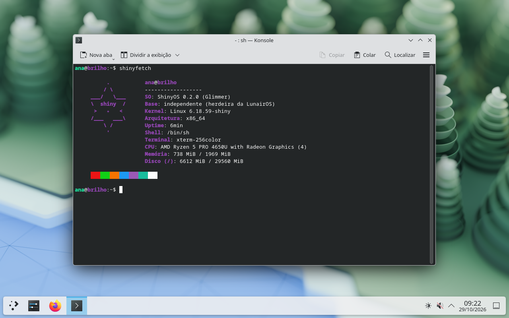

# ShinyOS ✦

[Português](README.md) • **English**

An independent Linux distro built from scratch, with KDE Plasma and a friendly face.



ShinyOS isn't based on any other distro. It brings together:

- the Linux kernel and BusyBox, compiled right here;
- a small BSD-style base system (`/etc/rc.conf` + `/etc/rc.d`);
- **Nix** for installing software, and the **KDE Plasma 6** desktop.

It carries on **LunairOS**, a friend's distro that was discontinued. Thank you for the foundation. 💜

**Current release:** 0.2.0 "Glimmer"

---

## Highlights

- 🖥️ **KDE Plasma 6** (Wayland) with Dolphin, Konsole, Kate, Okular, Gwenview, Firefox and the Oxygen theme
- 📶 **Wi-Fi** through the `wifi` command, with WPA2 and WPA3. Works with Intel, Realtek, MediaTek, Atheros and Broadcom cards
- 🔐 **sudo** for administrators (the `wheel` group)
- 📦 **100k+ programs** through Nix: `pkg install htop`
- 💿 **Guided installer** (in Portuguese):
  - picks the disk, user, keyboard and time zone through menus;
  - works on **UEFI and BIOS** machines.
- ⚙️ **`shiny` menu** for Wi-Fi, users, passwords, network, keyboard, time zone, services and packages
- 🛟 **ext4 disk**, checked automatically on every boot
- 🌙 **Live mode**: try it from a USB stick without installing anything

## Installing

1. Download or build the ISO (see below).
2. Write it to a USB stick. **Double-check `/dev/sdX`**: the chosen disk gets erased.

   ```sh
   sudo dd if=ShinyOS-Glimmer-0.2.0.iso of=/dev/sdX bs=4M status=progress conv=fsync
   ```

3. Boot from the stick. The welcome menu opens by itself.
4. If you need internet, choose **Conectar ao Wi-Fi** (wired works automatically).
5. Choose **Instalar a ShinyOS no computador** and answer the questions.
6. Reboot and log in with your user. KDE Plasma starts by itself.

**Requirements:**
- 64-bit (x86_64);
- 2 GB of RAM (4 GB recommended);
- 20 GB of disk;
- internet to install KDE (about 1.7 GB download).

## Using it

| I want to… | Command |
| --- | --- |
| Open the settings menu | `shiny` |
| Connect to Wi-Fi | `wifi` |
| Install a program | `pkg install vlc` |
| Search, list or remove programs | `pkg search editor` · `pkg list` · `pkg remove vlc` |
| Run something as administrator | `sudo command` |
| Install KDE later | `sudo shiny-desktop install` |
| Start KDE by hand | `shiny-session` |
| Show system info | `shinyfetch` |
| List and control services | `service -l` · `sudo service wifi restart` |
| Power off or reboot | `poweroff` · `reboot` |

System settings live in `/etc/rc.conf`, BSD-style:

```sh
hostname="brilho"
keymap="br-abnt2"
timezone="America/Sao_Paulo"
wifi_enable="YES"
desktop_autostart="YES"
```

## Known limitations

- There's no graphical login screen: Plasma starts when you log in on `tty1`.
- There's no driver for **NVIDIA** GPUs yet. Intel, AMD and virtual machines work.
- Enterprise Wi-Fi (eduroam) must be configured by hand.
- Bluetooth doesn't work yet.
- So far it has only been tested in virtual machines. Reports from real hardware are very welcome!

---

## Building

No root needed. First install the dependencies:

```sh
make install-deps-arch     # Arch, CachyOS, Manjaro
make install-deps-debian   # Debian, Ubuntu, Mint
```

Then:

```sh
make release
```

This downloads and compiles the kernel, BusyBox, sudo, wpa_supplicant and the rest of the base system, producing `build/ShinyOS-Glimmer-0.2.0.iso`. Every download is SHA-256 checked. The first build takes a while; later builds are quick.

### Testing in QEMU

```sh
make run            # live mode, BIOS
make run-uefi       # live mode, UEFI
make run-install    # live + a 20 GB virtual disk, to try the installer
make run-disk       # boot the installed virtual disk
```

For KDE, give the VM more memory: `make run-disk QEMU_MEM=2G`.

### Project layout

```text
configs/      kernel and BusyBox configs (+ ShinyOS fragments)
kernel/       Linux kernel build
busybox/      BusyBox build (static, musl)
ports/        sudo, wpa_supplicant (+OpenSSL, libnl), e2fsprogs and firmware
userland/     ShinyOS programs: shinyfetch, shiny-install, shiny-efiboot
rootfs/       system files: /etc, rc.d, menus, Nix and desktop setup
initramfs/    the boot /init (live mode and installed system)
iso/          GRUB and ISO generation
scripts/      build helper scripts
```

## Roadmap

- [x] Installable terminal system (UEFI and BIOS)
- [x] Package manager (`pkg`, on top of Nix)
- [x] Wi-Fi and sudo
- [x] KDE Plasma 6
- [ ] Testing on real hardware
- [ ] Graphical login screen
- [ ] Bluetooth and eduroam from the menu
- [ ] NVIDIA driver
- [ ] ShinyOS's own skeuomorphic theme

## License

ShinyOS is free software under the [GNU GPL v3.0](LICENSE).

Third-party software included or downloaded:

- Linux and BusyBox (GPLv2)
- GRUB (GPLv3)
- musl (MIT)
- Nix (LGPL-2.1)
- sudo (ISC)
- wpa_supplicant (BSD)
- OpenSSL (Apache-2.0)
- libnl (LGPL-2.1)
- e2fsprogs (GPLv2)
- linux-firmware (various licenses; see `WHENCE`)
- KDE Plasma and apps (GPL/LGPL, from nixpkgs)
